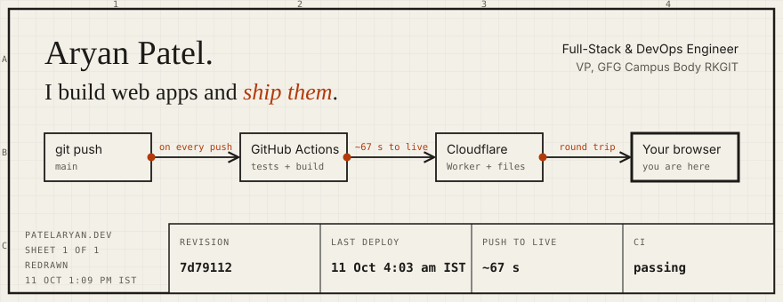

The drawing above is the deploy path of [patelaryan.dev](https://patelaryan.dev), and the numbers in its title block are real. A GitHub Action redraws it every day from my last commit and my last ten deploys.

I'm a final-year CSE student at RKGIT and Vice President of the GFG Campus Body RKGIT. I own projects end to end: the React app, the API behind it, and the pipeline that ships it. Looking for **Full-Stack and DevOps roles**.

### Proof, not adjectives

| | What it is | The part I'm proud of |
|---|---|---|
| **[GFG RKGIT platform](https://patelaryan.dev/work/gfg-rkgit)** | Website, admin portal and team portal for the club | 3 React apps on one Cloudflare Worker API. 300+ students have signed up on it through our events |
| **[prometheus](https://github.com/patelaryandev/prometheus)** | Expense Tracker API | Tests on every push, a Docker image per version tag, metrics and Sentry |
| **[clubs-rkgit](https://github.com/patelaryandev/clubs-rkgit)** | Directory of every RKGIT club | The whole directory is one JSON file that non-developers can edit |
| **[portfolio](https://github.com/patelaryandev/portfolio)** | This site | Push to live in about a minute, tests gate every deploy, the count is on the site |

### Hackathons

1st at Techtrix '25 (100+ teams) · 2nd at Binary Hacks 3.0 · 3rd at SRIJAN 2025

### Stack

React · JavaScript · Cloudflare Workers · Supabase · Firebase · FastAPI · PostgreSQL · Docker · GitHub Actions

### Reach me

[hi@patelaryan.dev](mailto:hi@patelaryan.dev) · [singh983853@gmail.com](mailto:singh983853@gmail.com) · [LinkedIn](https://www.linkedin.com/in/aryan-patel-865572327/) · [patelaryan.dev](https://patelaryan.dev)
